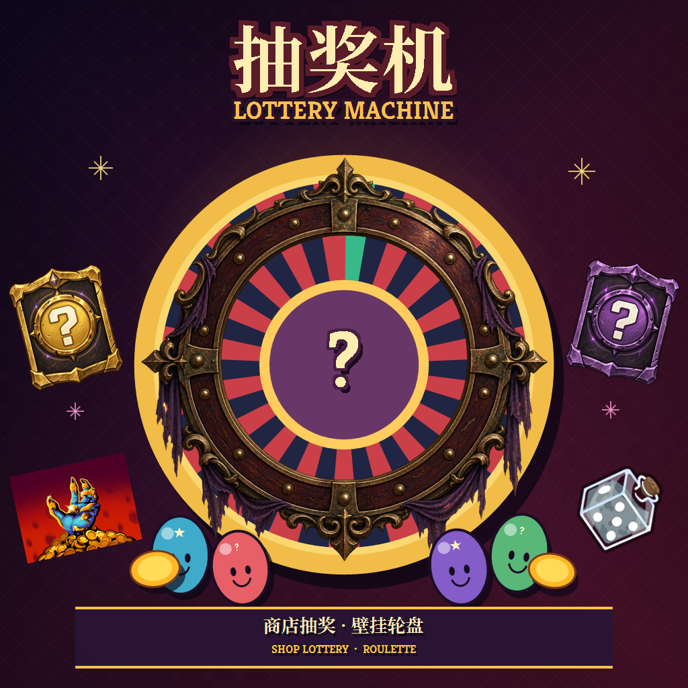
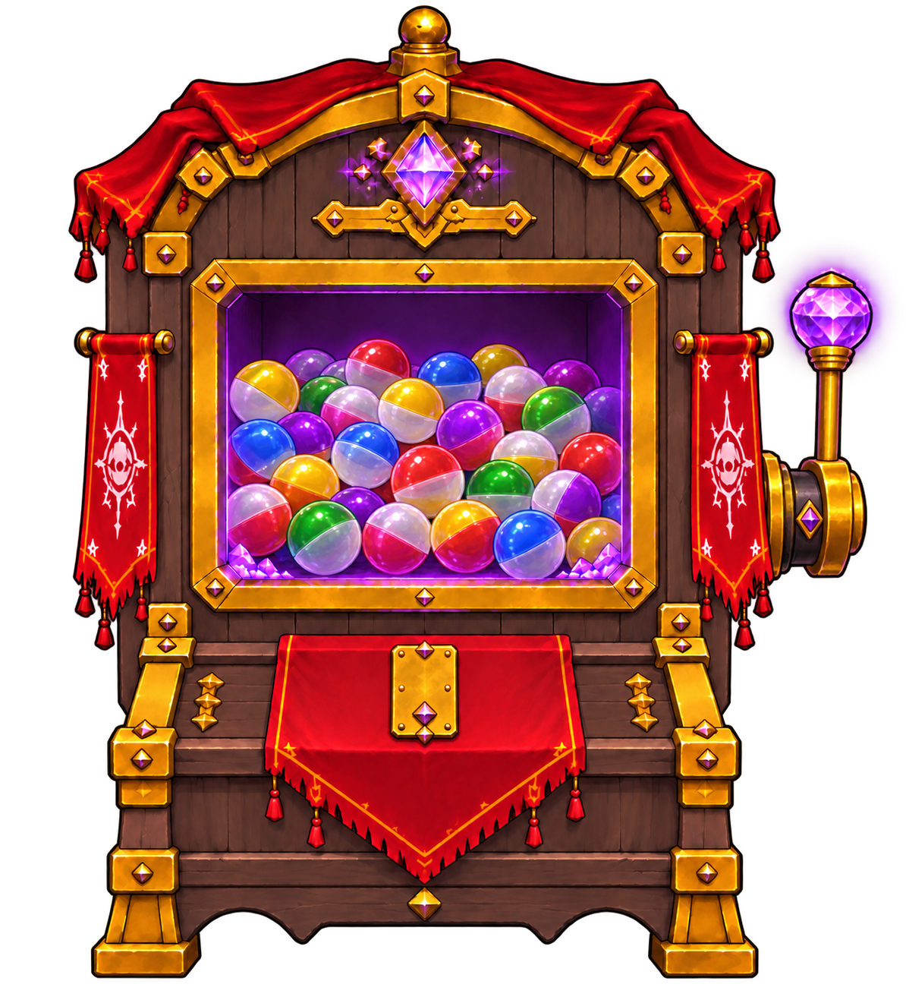

<p align="center">
  
</p>

<h1 align="center">抽奖机 · Lottery Machine</h1>

<p align="center">在《杀戮尖塔 2》的商店里，拉动抽奖机，或在命运轮盘上试试手气。</p>

<p align="center"><strong>V0.1.3</strong> · 只使用游戏内金币 · 无额外 Mod 依赖</p>

## 下载与安装

1. 下载 [V0.1.3 安装包](lottery_roulette-V0.1.3-install.zip)，并解压。
2. 在 Steam 库中右键《杀戮尖塔 2》→ **管理** → **浏览本地文件**，打开游戏目录。
3. 将解压得到的 `lottery_roulette` 文件夹放进游戏目录下的 `mods` 文件夹；没有 `mods` 时请自行创建。
4. 启动游戏并启用 Mod；如果游戏提示重启，按提示操作。

安装后目录应为：

```text
mods/
└── lottery_roulette/
    ├── lottery_roulette.json
    ├── lottery_roulette.dll
    └── lottery_roulette.pck
```

不要同时启用同一 Mod 的本地版和 Steam 创意工坊版。

> **兼容性：** 此版本基于 2026 年 9 月的游戏环境制作，尚未验证与当前游戏版本的兼容性。游戏更新后如出现异常，请先停用 Mod。

## 抽奖机

<p align="center"></p>

点击机台右侧的高亮拉杆，抽取当前角色卡牌、无色卡、诅咒、遗物或药水。抽奖价格从 **50 金币**开始，每次成功开奖增加 50，最高 **150 金币**。

卡牌、遗物和药水的综合权重为 **1:1:1**。卡牌品质权重如下：

| 普通 | 罕见 | 无色 | 稀有 | 诅咒 |
|:---:|:---:|:---:|:---:|:---:|
| 40% | 25% | 10% | 15% | 10% |

奖池中某类奖励不可用时，实际概率可能变化。无色卡以白色问号盲盒展示。

## 命运轮盘

用滚轮、滑条或快捷按钮选择金额，再押 **红色、黑色或绿色**。单次下注范围为 10～10000 金币，并受当前余额限制。红黑命中为 ×2，绿色命中为 ×35；奖金通过游戏奖励页面领取。

## 版本与反馈

V0.1.3 调整了抽奖价格上限和奖池权重，改用高亮拉杆，更新轮盘界面，并修复下注金额锁定及奖励结算问题。

遇到问题时，请描述游戏版本、Mod 版本、发生步骤，并附上错误日志或截图。

本 Mod 不涉及真实货币或现实收益。部分界面和装饰美术使用 AI 辅助生成。上方机台图为美术展示，非游戏截图。

<details>
<summary>安装包校验 SHA-256</summary>

`D5CBBF06BEBD7C6B9F204B1A00B2854BC47BBE8001DFF236413F22DF44933528`

</details>
